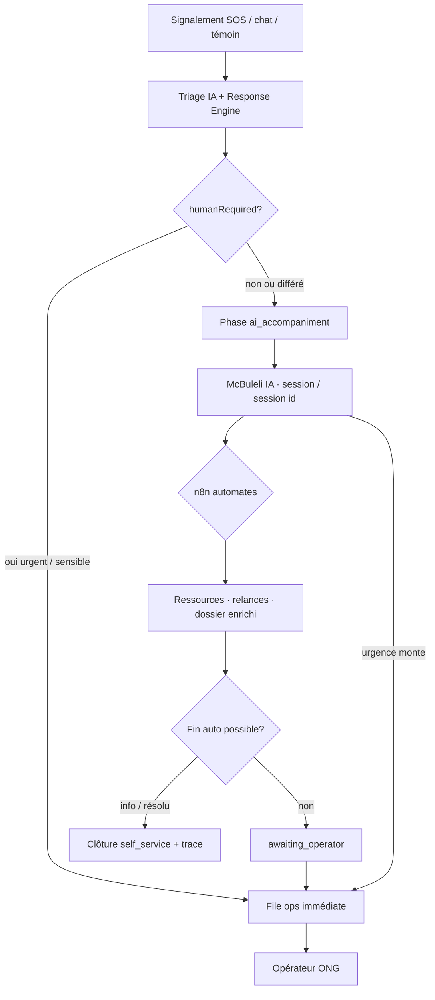

# NGEMBA RDC — Accompagnement IA + automates n8n (avant humain)

> Date : **5 novembre 2026** · mise à jour parcours **6 novembre 2026**  
> Statut : **écoute d'abord dans l'app** (SOS, École, Témoin, chat web). L'équipe est prévenue seulement si le danger est immédiat, si le récit est grave et déjà clair, ou si la personne demande un humain. Telegram et email suivent la même règle. WhatsApp pas encore branché.  
> Périmètre : **NGEMBA RDC uniquement** (`ngemba-rdc.org`).

---

## 1. Idée centrale

Entre **« j’ai un besoin »** et **« un·e opérateur·rice ONG me répond »**, il y a souvent un **délai** (file, nuit, pilote limité). Pour les situations **non immédiatement dangereuses**, NGEMBA doit pouvoir :

1. **Accompagner la victime automatiquement** via **McBuleli IA** (dialogue, questions, ressources, mode discret).
2. **Exécuter des automates** via **n8n** (relances, fiches, préparation dossier, timers SLA « humain »).
3. **Passer la main à un humain** dès que la politique l’exige ou que la situation **monte en urgence**.

L’humain n’est pas remplacé sur le sensible ; il intervient **plus tard** ou **plus tôt** selon le triage — avec un dossier déjà structuré.

Sur Telegram et l’email, un message non critique ne dit pas « un humain va vérifier ». McBuleli IA conseille. Elle alerte les agents seulement si le danger est immédiat, si la catégorie est une protection (violence, enfant), si la personne demande une personne de l’équipe, ou si le modèle juge qu’un conseil ne suffit plus. L’alerte ops part une seule fois (`agentsNotified`).

---

## 2. Trois briques (rôles stricts)

| Brique | Responsabilité | Ne fait pas |
|--------|----------------|-------------|
| **McBuleli IA** (NGEMBA) | Conversation citoyen · triage · résumé · `recommended_actions` · reclasser urgence | Envoyer SMS/email partenaire sans règle · décider seule sur VBG / danger immédiat |
| **Response Engine** (code) | Files autorisées · `humanRequired` · SLA · escalade | Workflows multi-outils externes |
| **n8n** | Automates **après** décision moteur · webhooks · cron · approbations ops | Prompts · chat SSE citoyen · login ops |

Référence moteur : [26-PHASE-2-AI-TRIAGE.md](./26-PHASE-2-AI-TRIAGE.md) · règles : `services/ngemba/src/lib/response-engine/rules.ts`.

---

## 3. Matrice urgence → parcours

| Urgence | Danger immédiat | Catégories sensibles | Parcours victime | Humain | n8n |
|---------|-----------------|----------------------|------------------|--------|-----|
| **critical** | oui | toute | SOS court · orientation urgence · file `operator_urgent` | **Immédiat** | Alerte ops · SLA 5 min · escalade [21-SLA-ESCALADE.md](./21-SLA-ESCALADE.md) |
| **high** | non | VBG, enfant, violence | File ops · IA **limitée** (pas long chat) | **Rapide** (< 20 min pilote) | Idem + rappels file |
| **medium** | non | hors liste protection | **Accompagnement IA** + plan d’actions | **Planifié** (SLA 60 min) ou handoff si IA demande | Relances · ressources · « dossier prêt » |
| **low** | non | hors liste protection | **Accompagnement IA** dominant | Handoff si demande ou fin auto impossible | Timers · clôture info avec trace |
| **info** | non | — | **Self-service IA** (+ répertoire) | Optionnel / async | Fiches · pas de file urgente |

**Toujours humain obligatoire** (moteur actuel, ne pas assouplir sans accord ONG + note juridique) :

- `critical` · `immediate_danger`
- Catégories : `vbg`, `sexual_violence`, `domestic_violence`, `child_danger`
- Source `school` · référent école
- Mode discret + risque agresseur (cf. [05-PROTOCOLE-OPERATEUR.md](./05-PROTOCOLE-OPERATEUR.md) § proches)

**Extension produit visée** : élargir l’**accompagnement IA** pour `medium` / `low` (aujourd’hui souvent `operator_standard` par défaut) **sans** retirer `humanRequired` quand la catégorie est sensible.

---

## 4. Phases de dossier (concept)

État métier proposé (stockage : `routingMeta.accompanimentPhase` en v1 · statut DB dédié plus tard si besoin).

| Phase | Code | Victime voit | Ops voit |
|-------|------|--------------|----------|
| Triage | `triage` | « On analyse votre message… » | — |
| Accompagnement IA | `ai_accompaniment` | Chat McBuleli IA · ressources · questions de sécurité | Dossier « en auto » · résumé IA |
| Automates | `automation_running` | « Nous préparons la suite… » (optionnel) | Journal n8n (externe) |
| En attente humain | `awaiting_operator` | SLA affiché ([05-PROTOCOLE-OPERATEUR.md](./05-PROTOCOLE-OPERATEUR.md) §7) | File · badges SLA |
| Pris en charge | `active` | Opérateur identifié | `assignedTo` |
| Orienté / clos | `oriented` / `closed` | Message de clôture | Stats · observatoire |

**Montée en urgence** (à tout moment) :

- Victime : « il est là », secousse SOS, nouveau message critical  
- IA : baisse confiance + `immediate_danger`  
- Moteur : `operator_urgent` · `humanRequired: true`  
- n8n : workflow `ngemba.urgency_upgraded` → annuler relances « douces » · alerter ops

---

## 5. Parcours (schéma)



---

## 6. McBuleli IA — contenu de l’accompagnement (non urgent)

Objectifs conversationnels (prompts : [03-PROMPTS-IA-DRAFT.md](./03-PROMPTS-IA-DRAFT.md), à spécialiser « accompagnement ») :

1. **Sécurité immédiate** : « Êtes-vous en sécurité pour parler ? » (oui/non · discret).
2. **Besoin** : écoute, orientation, abri, médical non urgent, information droits (sans conseil juridique ferme).
3. **Ressources** : liens `/resources`, annuaire partenaires [28-PHASE-4-DIRECTORY-REFERRAL.md](./28-PHASE-4-DIRECTORY-REFERRAL.md), numéros locaux **génériques** validés ONG.
4. **Préparation handoff** : résumé structuré pour l’opérateur (ne pas recopier tel quel à la victime).
5. **Reclasser** : si doute → `humanRequired` + sortie du parcours auto.

Limites : pas de promesse de délai garanti · pas de contact proche sans règles [19-PHILO-ORIENTATION-PROCHES.md](./19-PHILO-ORIENTATION-PROCHES.md).

---

## 7. n8n — workflows pilote (NGEMBA seulement)

Hébergement recommandé : **instance n8n séparée** du VPS `153.75` (RAM partagée McBuleli / Africa Insight / NGEMBA). Webhooks entrants depuis NGEMBA avec secret partagé (`NGEMBA_N8N_WEBHOOK_SECRET` — **à ajouter**, pas en prod aujourd’hui).

| # | Déclencheur | Actions n8n | But |
|---|-------------|-------------|-----|
| W1 | `ngemba.session.ai_accompaniment_started` | Log · timer SLA « humain si pas clos » | Cadre temporal |
| W2 | `ngemba.session.handoff_requested` | Email ops · ligne Sheet pilote · lien `/ops/{id}` | Humain avec contexte |
| W3 | `ngemba.alert_escalated` (existant) | Email + Telegram/Slack partenaire zone | SLA [21-SLA-ESCALADE.md](./21-SLA-ESCALADE.md) |
| W4 | `ngemba.session.self_service_closed` | Email récap anonymisable · stats | Clôture info |
| W5 | `ngemba.urgency_upgraded` | Stop timers W1 · W3 | Cohérence urgence |

Variables VPS déjà utiles : `NGEMBA_OPS_WEBHOOK_URL`, `NGEMBA_SMS_WEBHOOK_URL` ([`.env.example`](../../services/ngemba/ops/vps/.env.example)).

---

## 8. Contrat webhook (brouillon v1)

NGEMBA **émet** (POST JSON) ; n8n **consomme**. Signature recommandée : header `X-Ngemba-Signature: sha256=…` (HMAC secret).

### 8.1 Entrée accompagnement

```json
{
  "type": "ngemba.session.ai_accompaniment_started",
  "sessionId": "uuid",
  "urgency": "low",
  "category": "harassment",
  "queue": "operator_standard",
  "humanRequired": false,
  "accompanimentPhase": "ai_accompaniment",
  "locale": "fr",
  "discreteMode": false,
  "recommendedActions": ["resource_listening", "follow_up_24h"],
  "opsUrl": "https://ngemba-rdc.org/ops/{id}",
  "citizenSessionUrl": "https://ngemba-rdc.org/session/{id}",
  "time": "2026-11-05T12:00:00.000Z"
}
```

### 8.2 Handoff humain

```json
{
  "type": "ngemba.session.handoff_requested",
  "sessionId": "uuid",
  "reason": "victim_requested_human | sla_ai_max | ai_low_confidence | policy",
  "aiSummary": "…",
  "urgency": "medium",
  "slaDueAt": "2026-11-05T13:00:00.000Z"
}
```

### 8.3 Montée urgence

```json
{
  "type": "ngemba.urgency_upgraded",
  "sessionId": "uuid",
  "fromUrgency": "low",
  "toUrgency": "high",
  "immediateDanger": true
}
```

Événement **existant** à brancher tel quel sur n8n : `ngemba.alert_escalated` ([`notify-escalation.ts`](../../services/ngemba/src/lib/ops/notify-escalation.ts)).

---

## 9. Lien avec le code actuel

| Existant | Rapport avec cette spec |
|----------|-------------------------|
| File `self_service` · `humanRequired: false` | Cas **info** — base de l’auto |
| File `operator_standard` · défaut | Cible : sous-cas **medium/low** éligibles à `ai_accompaniment` avant file |
| `chatMessages` · `/session/[id]` | Canal McBuleli IA |
| `POST /api/ops/sla-tick` | n8n peut appeler en cron (token admin) |
| Escalade SLA | Déjà webhook + email |

**Travaux implémentation** (ordre suggéré) :

1. Politique Response Engine : règles `medium`/`low` → `ai_accompaniment` + `humanRequired` explicite ([`rules.ts`](../../services/ngemba/src/lib/response-engine/rules.ts)).
2. API : émettre webhooks `ai_accompaniment_started` / `handoff_requested` / `urgency_upgraded`.
3. UI session : états victime alignés §4.
4. n8n : W1–W5 + secret HMAC.
5. Pilote ONG : valider scripts IA + durées max en auto ([12-ACCORD-PILOTE-JGL.md](./12-ACCORD-PILOTE-JGL.md) · BCA [31-BCA-BLOC-CITOYEN-AMANI.md](./31-BCA-BLOC-CITOYEN-AMANI.md)).

---

## 10. Métriques pilote

| Indicateur | Cible indicative |
|------------|------------------|
| Temps jusqu’à **première réponse utile** (IA) | < 30 s |
| % dossiers `medium/low` clos en auto **sans** dégradation satisfaction | À définir avec ONG |
| % handoff avec résumé IA utilisé par ops | > 80 % |
| Aucune alerte **critical** restée > 5 min sans ack humain | 100 % heures pilote |
| Escalade `urgency_upgraded` tracée | 100 % |

---

## 11. Documents liés

- [05-PROTOCOLE-OPERATEUR.md](./05-PROTOCOLE-OPERATEUR.md) — scripts humains · SLA citoyen
- [21-SLA-ESCALADE.md](./21-SLA-ESCALADE.md) — escalade automatique
- [35-MULTICANAL-N8N-TELEGRAM-EMAIL.md](./35-MULTICANAL-N8N-TELEGRAM-EMAIL.md) — Telegram · email · WhatsApp via n8n
- [06-PLAN-COMBINE-OPENAI.md](./06-PLAN-COMBINE-OPENAI.md) — McBuleli IA au centre
- [04-NOTE-JURIDIQUE-BROUILLON.md](./04-NOTE-JURIDIQUE-BROUILLON.md) — validation avant extension auto
- [33-SAFETY-CHECK-FUTURE.md](./33-SAFETY-CHECK-FUTURE.md) — **distinct** (crise collective, plus tard)

---

*Document v1.0 — NGEMBA RDC — McBuleli IA + n8n + handoff humain*
