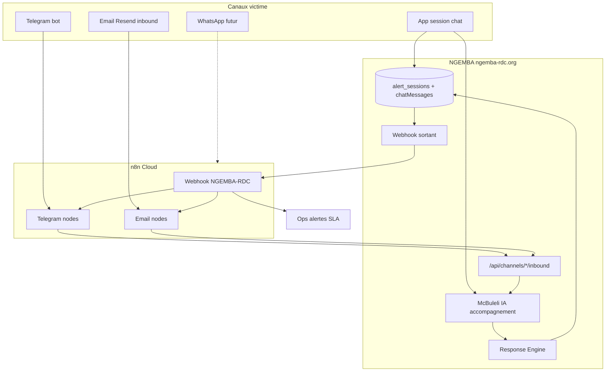

# NGEMBA RDC — Multicanal (Telegram, email, WhatsApp) via n8n

> Date : **5 novembre 2026**  
> Statut : **spécification architecture** (API canaux ⏳ · workflows n8n pilote ⏳)  
> Périmètre : **NGEMBA RDC** uniquement · complète [34-ACCOMPAGNEMENT-IA-N8N.md](./34-ACCOMPAGNEMENT-IA-N8N.md)

---

## 1. Objectif

Permettre aux victimes / citoyens d’être **assistés par McBuleli IA** (triage + accompagnement non urgent) et **servis sur plusieurs canaux** :

| Canal | Phase pilote | Rôle |
|-------|--------------|------|
| **App web / PWA / APK** | ✅ existant | SOS, session, chat ops |
| **Telegram** | v1 n8n | Dialogue assisté · discret · faible data mobile |
| **Email** | v1 n8n | Fil async · personnes sans messagerie instantanée |
| **WhatsApp** | v2 | Même hub n8n · fournisseur à choisir (Meta / bridge) |

**n8n** (`https://mcbuleli.app.n8n.cloud`) = **transport, timers, relances, notifications** — pas le cerveau IA.

**McBuleli IA** (dans NGEMBA) = prompts, garde-fous, reclassement urgence, réponses auto encadrées.

**Jeunesse / école** = surfaces d’**interaction auto** (pédagogie, scénarios) avec **sorties** vers n8n (ressources, alerte référent) sans remplacer l’humain sur dossiers sensibles.

---

## 2. Règle d’or (source de vérité)

```text
┌──────────────────────────────────────────────────────────┐
│  NGEMBA serveur (sessionId, chatMessages, triage, audit) │
│  McBuleli IA + Response Engine                           │
└─────────────────────────┬────────────────────────────────┘
                          │ webhooks événements
                          │ API inbound canaux (secret)
                          ▼
┌──────────────────────────────────────────────────────────┐
│  n8n Cloud — Telegram · Email · (WhatsApp) · cron        │
└──────────────────────────────────────────────────────────┘
```

| Interdit | Autorisé |
|----------|----------|
| Historique canonique **only** in n8n | Copie / miroir pour envoi canal |
| n8n appelle OpenAI pour réponses victime | n8n appelle **`POST /api/channels/.../inbound`** |
| Chaque message app passe par n8n | App → NGEMBA direct · n8n seulement **sortant** ou **inbound externe** |
| Bot école remplace référent humain | Bot **info + orientation** · file `school_referent` inchangée |

---

## 3. Architecture logique



---

## 4. Phases dossier + canaux

Aligné [34-ACCOMPAGNEMENT-IA-N8N.md](./34-ACCOMPAGNEMENT-IA-N8N.md) · champ proposé `routingMeta.channels[]`.

| Phase | App | Telegram | Email |
|-------|-----|----------|-------|
| `triage` | UI session | 1er message bot | Objet + corps initial |
| `ai_accompaniment` | Chat + IA ops | Messages bot ↔ API inbound | Réponses sous 24–48 h pilote |
| `awaiting_operator` | SLA affiché | « Un opérateur va reprendre » | Email statut |
| `active` | Chat humain | Transfert humain (option) ou lien app | Email ops / victime |

**Canal préféré** : enregistré sur la session pour les **sortants** n8n (`primaryChannel: telegram | email | app`).

---

## 5. Matrice jeunesse & école

| Surface | IA (NGEMBA) | n8n | Humain |
|---------|-------------|-----|--------|
| **`/jeunesse/[scenario]`** | `runYouthChat` · `suggest_sos` | Si `suggest_sos` → webhook `ngemba.youth.escalate` · fiche ressources email | SOS → file standard |
| **Fin scénario (option)** | Résumé local | `ngemba.youth.scenario_completed` → Sheet pilote stats | — |
| **`/school` alerte** | Triage · catégorie école | `ngemba.school.new_alert` → email référent token école | **Obligatoire** prise en charge |
| **École prévention (futur)** | FAQ référent **sans** dossier VBG | Newsletter ressources Safe School | Référent valide contenu |

Code actuel : jeunesse **sans** session ops tant que pas de SOS · école **`humanRequired: true`** (`rules.ts`).

---

## 6. Événements NGEMBA → n8n (sortants)

Base URL workflow : `NGEMBA_OPS_WEBHOOK_URL` → webhook Production n8n (workflow **NGEMBA-RDC**).

Header recommandé (impl. ⏳) : `X-Ngemba-Signature: sha256=<hmac>` avec `NGEMBA_N8N_WEBHOOK_SECRET`.

| `type` | Quand | Action n8n typique |
|--------|-------|-------------------|
| `ngemba.alert_escalated` | ✅ existant | Alerte ops · Telegram groupe · email |
| `ngemba.session.ai_accompaniment_started` | Phase auto | Timer SLA · choix canal sortant |
| `ngemba.message.outbound` | Réponse IA ou ops à relayer | Telegram send · email reply |
| `ngemba.session.handoff_requested` | Victime ou IA | Email file · désactiver relances douces |
| `ngemba.urgency_upgraded` | Montée urgence | Stop timers · alerte urgent |
| `ngemba.youth.escalate` | `suggest_sos: true` | Message ressources + lien SOS |
| `ngemba.school.new_alert` | `source: school` | Notify référent · pas de bot victime |

### 6.1 Exemple `ngemba.message.outbound`

```json
{
  "type": "ngemba.message.outbound",
  "sessionId": "uuid",
  "channel": "telegram",
  "channelAddress": "123456789",
  "body": "Texte à envoyer (déjà validé par NGEMBA)",
  "role": "assistant",
  "locale": "fr",
  "discreteMode": false,
  "citizenSessionUrl": "https://ngemba-rdc.org/session/uuid"
}
```

n8n **ne modifie pas** le texte sauf template fixe (signature, lien app).

---

## 7. API canaux NGEMBA ← n8n (inbound) — à implémenter

Auth : `Authorization: Bearer <NGEMBA_CHANNEL_INBOUND_SECRET>` (min 32 car.) · rate limit IP + idempotency.

### 7.1 `POST /api/channels/telegram/inbound`

```json
{
  "idempotencyKey": "tg:update:12345",
  "telegramUserId": "123456789",
  "telegramChatId": "123456789",
  "text": "message victime",
  "locale": "fr",
  "sessionId": "uuid-optionnel",
  "meta": { "username": "optional" }
}
```

**Réponse 200 :**

```json
{
  "sessionId": "uuid",
  "created": false,
  "replies": [
    { "body": "Réponse McBuleli IA", "role": "assistant" }
  ],
  "suggestHumanHandoff": false,
  "urgency": "low"
}
```

n8n envoie chaque `replies[]` au chat Telegram.

**Création session** : si pas de `sessionId`, NGEMBA crée alerte `source: chat` · triage · phase `ai_accompaniment` si éligible.

### 7.2 `POST /api/channels/email/inbound`

Pour **Resend inbound** ou parsing n8n (From, Subject, body, `In-Reply-To`).

```json
{
  "idempotencyKey": "em:message-id@domain",
  "from": "victime@example.com",
  "subject": "NGEMBA aide",
  "text": "corps plain text",
  "inReplyToSessionToken": "optional-short-token"
}
```

Réponse : même forme que Telegram · `replies[]` → n8n **Send email** (Resend).

### 7.3 `POST /api/channels/link`

Lie Telegram ↔ session existante (QR / code dans app).

```json
{
  "sessionId": "uuid",
  "channel": "telegram",
  "channelAddress": "123456789",
  "linkCode": "8-char-from-app"
}
```

---

## 8. Workflows n8n pilote (NGEMBA-RDC)

Instance : **n8n Cloud** (pas le VPS `153.75`).

| ID | Nom | Trigger | Actions |
|----|-----|---------|---------|
| W0 | **Router ops** | Webhook POST (Production) | Switch sur `$json.body.type` ou `$json.type` |
| W1 | Escalade SLA | `ngemba.alert_escalated` | Email `info@` · BCC CEO · (Telegram ops) |
| W2 | Outbound Telegram | `ngemba.message.outbound` + channel=telegram | Telegram Send Message |
| W3 | Outbound email | `ngemba.message.outbound` + channel=email | Resend |
| W4 | Inbound Telegram | Telegram Trigger | HTTP → `/api/channels/telegram/inbound` → boucle replies |
| W5 | Inbound email | Email Trigger / IMAP | HTTP → `/api/channels/email/inbound` |
| W6 | Jeunesse SOS | `ngemba.youth.escalate` | Email ressources + lien `/sos` |
| W7 | École nouvelle alerte | `ngemba.school.new_alert` | Email référent (pas de données sensibles dans objet) |

**Ordre de mise en prod :** W0 + W1 (✅ amorcé) → W4 + W2 → W5 + W3 → W6 → W7 → WhatsApp clone W4/W2.

Credentials n8n : **Telegram Bot** · **Resend** (même domaine `ngemba-rdc.org` si possible) · **HTTP Header** pour secret NGEMBA.

---

## 9. Chat in-app vs n8n

| Flux | Chemin |
|------|--------|
| Message **citoyen → ops** (phase humain) | `POST /api/alerts/{id}/messages` (existant) |
| Message **citoyen → IA** (phase auto) | **Nouveau** : même route ou `POST /api/alerts/{id}/ai-reply` interne · IA dans NGEMBA · webhook `message.outbound` **seulement si** victime a aussi Telegram/email |
| Message **Telegram** | n8n → inbound API → IA → n8n send |
| **Ops** écrit dans dossier | Inchangé · pas via n8n |

Objectif : **une** timeline `chatMessages` dans la session, quelle que soit l’origine (`origin: app | telegram | email | operator`).

---

## 10. Garde-fous multicanal

1. **Response Engine** inchangé sur critical / VBG / école / `immediate_danger`.
2. **Mode discret** : pas de push Telegram bruyant · textes courts · pas de preview nom agresseur.
3. **Email** : pas de détails VBG dans l’objet · chiffrement transport only (TLS).
4. **Idempotency** : clés `idempotencyKey` obligatoires côté n8n (Telegram update_id, Message-Id).
5. **Audit** : chaque inbound/outbound journalisé (`incident_events` ou jsonb history).
6. **WhatsApp v2** : même API inbound · templates Meta approuvés pour **premier** contact hors 24 h.

Références : [05-PROTOCOLE-OPERATEUR.md](./05-PROTOCOLE-OPERATEUR.md) · [04-NOTE-JURIDIQUE-BROUILLON.md](./04-NOTE-JURIDIQUE-BROUILLON.md) · [11-SECURITE-CYBER.md](./11-SECURITE-CYBER.md).

---

## 11. Variables d’environnement

VPS `/opt/ngemba/ops/vps/.env` · voir [`services/ngemba/ops/vps/.env.example`](../../services/ngemba/ops/vps/.env.example).

| Variable | Où | Usage |
|----------|-----|--------|
| `NGEMBA_OPS_WEBHOOK_URL` | VPS | URL webhook Production n8n |
| `NGEMBA_N8N_WEBHOOK_SECRET` | VPS + n8n | HMAC sortant (⏳ code) |
| `NGEMBA_CHANNEL_INBOUND_SECRET` | VPS + n8n HTTP node | Auth inbound API |
| `N8N_SERVER_URL` / `N8N_KEY_TOKEN` | `.env` dev Mac | MCP agent · **pas** sur VPS prod |
| Telegram bot token | **n8n credentials** | Jamais dans NGEMBA |

Dev local McBuleli monorepo : `N8N_*` dans `.env` racine pour automatisation agent — **ne pas committer**.

---

## 12. Plan d’implémentation

| Étape | Livrable | Dépendance |
|-------|----------|------------|
| **M0** | W0/W1 n8n + `NGEMBA_OPS_WEBHOOK_URL` prod | ✅ webhook test 200 |
| **M1** | `routingMeta.accompanimentPhase` + webhooks spec 34 | Code NGEMBA |
| **M2** | `/api/channels/telegram/inbound` + W4/W2 | Bot Telegram créé |
| **M3** | IA replies in-app phase auto + `message.outbound` | M1 |
| **M4** | Email inbound/outbound W5/W3 | Resend inbound ou parsing |
| **M5** | Events jeunesse / école W6/W7 | Accord pilote ONG |
| **M6** | WhatsApp | Fournisseur + templates |

---

## 13. Métriques

| KPI | Cible pilote |
|-----|----------------|
| Temps 1ère réponse IA (Telegram) | < 15 s |
| Sessions multicanal avec même `sessionId` | Traçabilité 100 % |
| Critical sans ack humain < 5 min | 100 % |
| Messages victime générés **only** by n8n sans NGEMBA | **0** |

---

## 14. Documents liés

- [34-ACCOMPAGNEMENT-IA-N8N.md](./34-ACCOMPAGNEMENT-IA-N8N.md) — phases auto avant humain
- [26-PHASE-2-AI-TRIAGE.md](./26-PHASE-2-AI-TRIAGE.md) — Response Engine
- [21-SLA-ESCALADE.md](./21-SLA-ESCALADE.md) — escalade
- [14-PHASE-2.md](./14-PHASE-2.md) · [16-PHASE-3B.md](./16-PHASE-3B.md) — chat session · mobile
- [17-PHASE-4.md](./17-PHASE-4.md) — école · jeunesse

---

*Document v1.0 — NGEMBA RDC multicanal · n8n Cloud · McBuleli IA*
